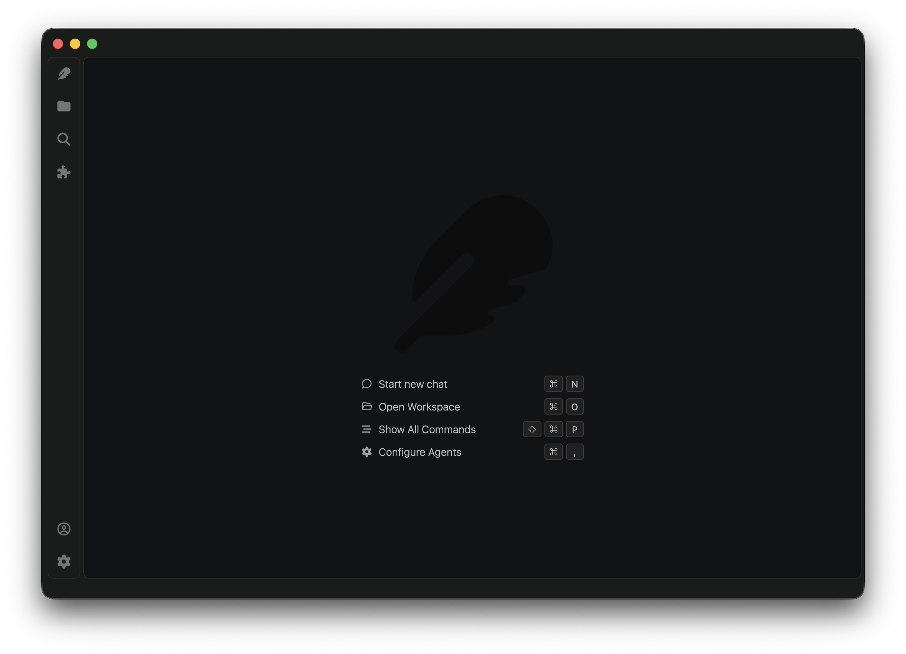
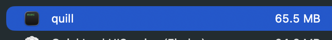

# Quill

## The lightweight, native desktop harness for every LLM

- Native Desktop UI APIs (No Electron)
- Minimal resource footprint, under 70mb of ram
- Extremely fast Rust core
- Supports every LLM provider, no lock down

<i>Based on VSCode's design</i>

 

## Downloads

Download from Github releases and run. Uses portable executables so no install is required.

To uninstall delete the executable and the config under `$HOME/.config/quill`.

|Platform|Link|
|-|-|
|Windows|[quill.exe](https://github.com/alshlabs/quill/releases/latest/download/quill-windows-amd64.zip)|
|Windows Arm64|[quill.exe](https://github.com/alshlabs/quill/releases/latest/download/quill-windows-arm64.zip)|
|MacOS|[Quill.app](https://github.com/alshlabs/quill/releases/latest/download/quill-macos-arm64.tar.gz)|
|Linux|[Quill.AppImage](https://github.com/alshlabs/quill/releases/latest/download/quill-linux-amd64.tar.gz)|
|Linux Arm64|[Quill.AppImage](https://github.com/alshlabs/quill/releases/latest/download/quill-linux-arm64.tar.gz)|

_Note: the MacOS build is unsigned because I am not spending US$99/year for an Apple developer account_

## Demo

https://github.com/user-attachments/assets/8335baf6-c4ed-4f25-a554-4dc7140fc3c7

## How does this work?

Quill leverages the work done by the [Zed editor](https://zed.dev/), utilizing their cross platform [gpui-kit](https://crates.io/crates/gpui-kit).

Simply put, gpui leverages native APIs (Metal, Vulkan and DirectX) to draw the UI. You can think of it as using a game engine to render a UI, except it only renders frames when things are moving, ensuring power usage / battery life is unaffected.

## Motivation for this project

All the current desktop harnesses are built on top of Electron (basically a full-fat dedicated clone of Chrome running only one website, their UI).

Conventionally, this is done to minimize the friction associated with cross-platform application development and be competitive in feature delivery. Essentially, sacrifice a little user experience in exchange for the ability to move faster than competitors.

In my view, harnesses have reached a level of maturity now where the features we expect from them are well enough defined. In addition,there is no longer the pressure to be a first mover in the Desktop Agent Harness space. 

I think we can now afford a high quality tool that respects your computers resources while also supporting all model providers.

Additionally, the technology powering Quill means that adding features is not so hard that it justifies an Electron build.

## Credits & Licenses

* UI Icons from [Codicons](https://github.com/microsoft/vscode-codicons) by Microsoft ([CC BY 4.0](https://github.com/microsoft/vscode-codicons/blob/main/LICENSE)).
* UI Icons from [Font Awesome Free](https://github.com/FortAwesome/Font-Awesome) by Fonticons, Inc. ([CC BY 4.0](https://fontawesome.com/license/free)).
* UI Icons from [Bootstrap Icons](https://github.com/twbs/icons) by The Bootstrap Authors ([MIT](https://github.com/twbs/icons/blob/main/LICENSE)).
* UI framework [GPUI](https://github.com/zed-industries/zed/tree/main/crates/gpui) from the [Zed](https://zed.dev) editor by Zed Industries ([Apache 2.0](https://github.com/zed-industries/zed/blob/main/crates/gpui/LICENSE-APACHE)).

## License

I have gone with an unconventional non-commercial license that has an clause for AI training. I'm not anti-AI at all (obviously) and have no expectations that my license will be respected. 

The intention is that - should this code be included in training data - throw a little something my way for the training data.

If you're doing research or working on an open weight model, feel free to include this in your training data.

## Support The Development

This is a weekend project of mine. If you genuinely enjoy it and want to see more, please consider starring the repo and supporting my efforts.

<a href="https://wise.com/pay/me/davidsama1">

<i>Donate with Wise</i>

</a>

